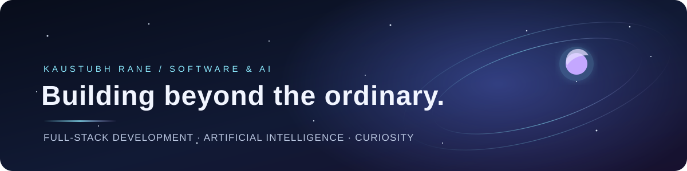

  

<h1 align="center">Kaustubh Rane</h1>

  <b>Information Technology Student • Full-Stack Developer • AI Enthusiast</b>

  

  
  

---

## About Me

I'm an Information Technology student with a focus on **full-stack development, artificial intelligence, and software engineering**. I enjoy building practical software that combines clean interfaces, solid backend systems, databases, APIs, and intelligent features.

I'm currently strengthening my foundations in **Java, Data Structures & Algorithms, Full-Stack Development, and AI**, while working on my current project — an **Exam Cell Automation System** — which is in active development.

I'm open to **internship and software engineering opportunities**.

> Build. Learn. Break. Fix. Improve.

<i>Curious by nature. Building one small piece of the future at a time.</i>

---

## Tech Stack

**Languages**

**Frontend**

**Backend & Databases**

**Tools & Engineering**

**AI / Data**

- Python
- CatBoost
- SHAP
- LangChain
- Gemini
- AI Integrations

---

## GitHub Stats

  
  

---

## Development Activity

  

---

## Contribution Snake

  <picture>
    <source media="(prefers-color-scheme: dark)" srcset="https://raw.githubusercontent.com/kaustubh2049/kaustubh2049/output/github-contribution-grid-snake-dark.svg" />
    <source media="(prefers-color-scheme: light)" srcset="https://raw.githubusercontent.com/kaustubh2049/kaustubh2049/output/github-contribution-grid-snake.svg" />
    
  </picture>

<i>Contribution activity visualized through GitHub Actions.</i>

---

## GitHub Trophies

  

---

## Current Focus

**Project:** Exam Cell Automation System — *in active development*

Automating examination workflows and academic record management for exam cell staff, including:

- Student academic records
- Marks processing
- Semester / branch schemes
- Result processing
- Examination document generation

**Learning:**

- Java, Data Structures & Algorithms *(active)*
- Backend Engineering, PostgreSQL *(active)*
- System Design *(in progress)*
- AI Engineering *(exploring)*

---

## Achievements

- 🏆 3rd Rank — CodeSprint Hackathon, Xavier Institute of Engineering
- 🏆 5th Rank — SprintNova Hackathon
- 🥉 3rd Place — Project Exhibition, Semester VI

---

## Connect With Me

  
  
  
  

  

<b>Open to internships, software engineering opportunities, and collaborations.</b>

---

  

